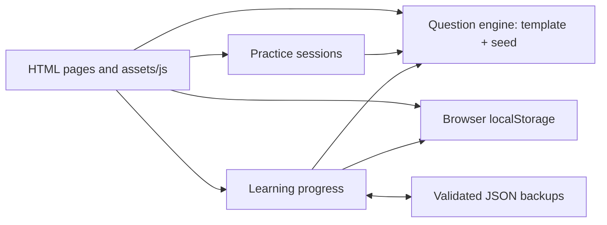

# Engineering notes

Axiom supports a complete practice loop: choose a skill, answer reproducible questions, review the reasoning, and return to mistakes. It is a static learning application with original mathematical templates. It does not train or evaluate AI models.

## How the pieces fit together



- [Question engine](../src/questions/index.js): registers templates, validates input, generates deterministic items and selects question sets. Domain-specific generators return the question, answer and worked explanation.
- [Session model](../src/practice/session.js): creates, restores, grades and finishes sessions. It accepts an explicit clock value for deterministic timing tests.
- [Progress model](../src/learning/progress.js): validates and regrades attempts, keeps bounded first-attempt history, and merges backups.
- [Browser controllers](../assets/js/): render those models, handle forms and keyboard interaction, persist sessions, and display storage failures.
- [Build script](../scripts/build.mjs): copies an explicit public-file list into `dist/` and rejects missing local dependencies. GitHub Actions runs the test-gated build on pushes and pull requests; Cloudflare Pages uses the same build command for deployment.

## Design decisions and their costs

### Static pages and native browser APIs

HTML, CSS and JavaScript are served directly. This keeps deployment small and avoids maintaining a server, account system or package dependency tree. The cost is that rendering and state transitions are maintained explicitly in the page controllers.

Progress belongs to a browser origin and does not automatically sync across devices. Storage can be blocked, corrupted or cleared. The interface reports persistence failures and offers a downloadable backup; it does not promise cloud durability.

### Reproducible questions instead of a stored question database

A template ID and seed identify an exact item. This supports shareable links, reproducible failures and lightweight saved sessions. Generation uses ordinary mathematical code, rather than a model API.

Changing a generator can change old links and saved answers. The release audit therefore checks fingerprints of previously published items, and session migration preserves stored question identities when the catalog expands. A large parameter space gives many numerical variations; it is not the same as that many distinct concepts or independently authored exercises.

### First attempts and practice retries have different purposes

The first recorded valid attempt for a template/seed pair contributes to progress while that question remains in the retained history. Practice answers can change before a session finishes; finishing records the graded attempts. Retrying a retained question helps practice without replacing the original result. History is bounded to 500 distinct questions, and overlapping backups keep the earliest attempt.

This makes the displayed accuracy interpretable, but it is not an adaptive mastery model or a prediction of an official SAT score. A learner can improve on a retry without changing the first-attempt percentage.

### Validation before persistence

Imported JSON is treated as untrusted input. The progress model checks size, format, version, identities and responses, regenerates questions to recompute correctness, and validates the full import before writing merged data. A failed import must preserve existing progress.

This protects local data integrity; it is not an anti-cheating system. All application code and answers run in the browser, and the device owner controls browser storage.

## Concrete reliability examples

**Question-set coverage.** An earlier selection loop skipped templates in even-sized pools. Selection now advances by the number of accepted items, while duplicate stems are retried. The regression checks that every template is reached. See the [fix](https://github.com/TARUNTEjjjj/axiom-sat/commit/1a4625b), [selection code](../src/questions/index.js) and [registry tests](../tests/registry.test.js).

**Sessions surviving catalog changes.** Recreating an old session from a top-level seed after adding templates can select different questions. Restoration instead retains the saved question identities and migrates the supported session version. A frozen fixture from the original 19-template catalog verifies that answers, flags and deadlines survive. See [session code](../src/practice/session.js) and [practice tests](../tests/practice.test.js).

**Backups preserving history.** Malformed files, duplicate identities, unknown questions and unsupported versions are rejected before storage is changed. Stored correctness flags are recomputed from generated questions. See [progress code](../src/learning/progress.js) and [import regressions](../tests/progress.test.js).

## Verification and limits

Run:

```sh
npm run build
npm run audit:questions
```

The shared Node/browser test suite covers question invariants, numeric grading, session timing and migration, retries, and progress recovery. [Independent mathematical audits](../tests/math-audit.test.js) use alternative solution methods, including enumeration, interpolation and elimination, so correctness checks do not rely only on a generator's own verifier.

The [release verification record](verification.md) describes measured coverage and manual browser checks. Finite seed samples do not prove correctness for every possible seed. Browser checks are not a complete cross-browser or assistive-technology certification, and the app has no psychometric calibration or demonstrated SAT-score prediction.

## Proposed next work

These are future tasks, not claims of completed features.

| Task | Evidence of completion |
| --- | --- |
| Broader browser and accessibility checks | Record browser versions and keyboard/screen-reader results for setup, question navigation, finish/cancel, review, and backup restoration; add regression coverage for defects found. |
| New original question families | Add a template with explicit domain constraints, worked reasoning, an independent solver or mathematical oracle, and representative edge-case checks. |
| Automated browser regression checks | Exercise a small set of complete learner journeys, including timed reload, exact-question retry, and failed backup import, with clear failure reports. |

For current contributor rules and release steps, see [CONTRIBUTING.md](../CONTRIBUTING.md).
